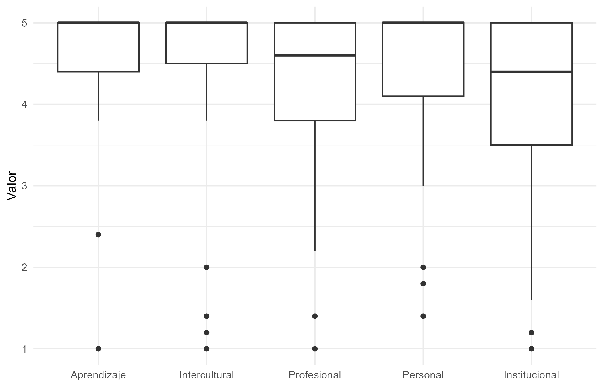
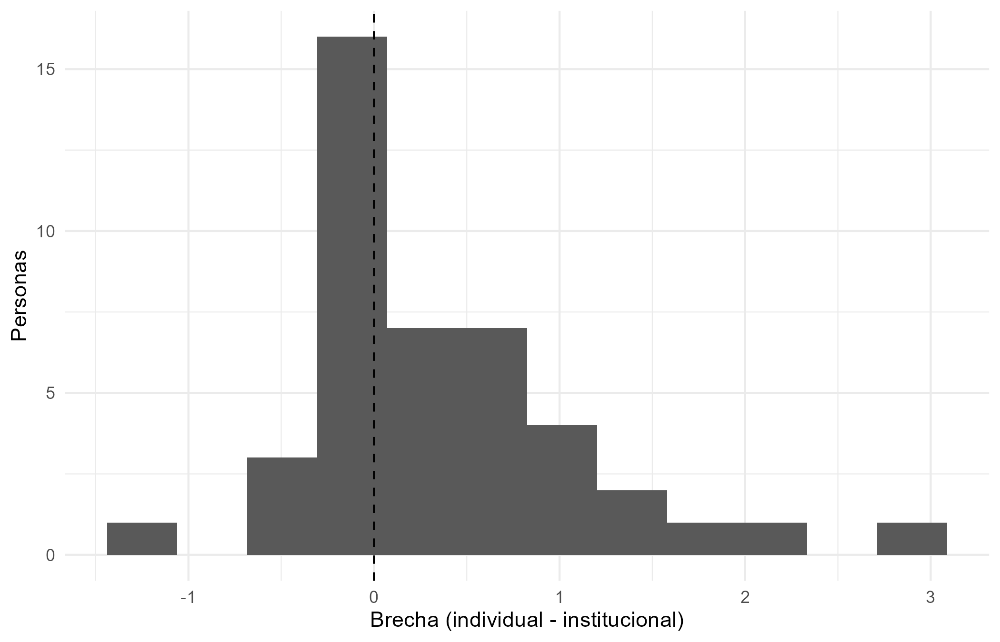
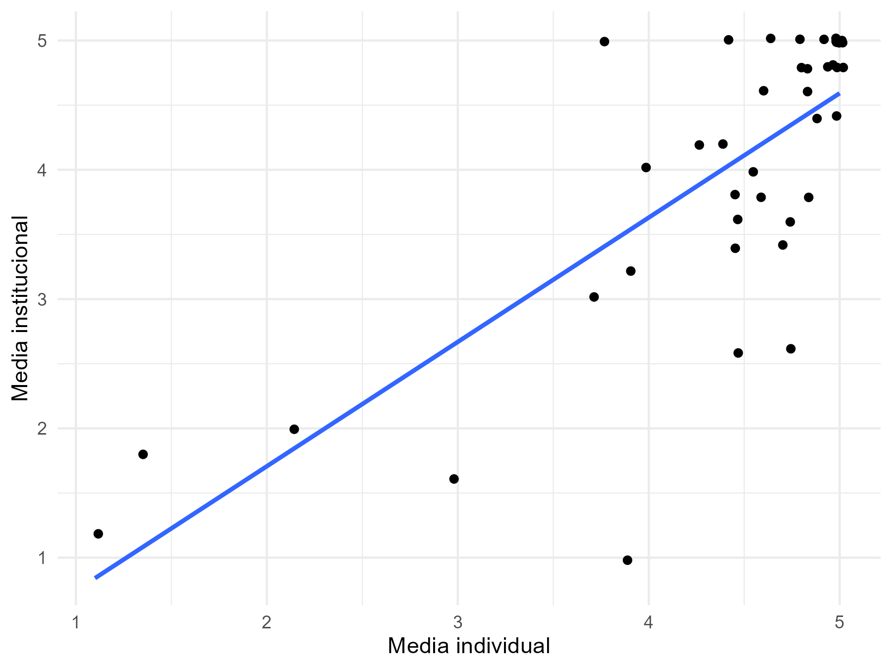

**¿Cómo se distribuyen los resultados reportados de las experiencias internacionales entre dimensiones individuales e institucionales y qué revela el caso de la Universidad Nacional de Loja sobre la transferencia del aprendizaje internacional hacia capacidades organizacionales?**

## 1. Introducción

La internacionalización de la educación superior pasó de ser un conjunto de iniciativas individuales a concebirse como un proceso estratégico e institucional, que requiere políticas y liderazgo [@hudzik_2015; @leask_2014; @beelen_jones_2015]. En América Latina ese proceso ha sido desigual y se ha centrado en la movilidad [@gacel_2007; @dewit_gacel_knobel_2017; @vazquez_mancilla_2025]. La comparación regional disponible no incluye a Ecuador [@gacel_etal_2024], donde se ha estudiado sobre todo la transferencia de conocimiento entre instituciones aliadas [@leon_etal_2014].

La literatura sobre resultados se ha concentrado en el individuo: aprendizaje y competencia intercultural [@varela_2017; @bartelradic_cucchi_2025], idiomas [@higuchi_etal_2023] y resultados laborales, con evidencia heterogénea [@iriondo_2020; @wiersjenssen_storen_2021; @arcidiacono_etal_2026]. Las revisiones señalan que la investigación sigue siendo dispersa y descriptiva [@mittelmeier_etal_2024; @roy_etal_2019].

Hay menos evidencia sobre cómo lo aprendido se convierte en capacidad de la organización. Los estudios disponibles, casi todos cualitativos, indican que los beneficios individuales no se transfieren automáticamente: dependen del clima organizacional, de los roles y de las alianzas [@ramirez_ortega_2019; @enkhtur_etal_2025; @akkad_2026; @hanley_chankseliani_2026]. Falta evidencia que compare ambas dimensiones dentro de una misma universidad latinoamericana.

A esto se suma un problema de definición. Los intercambios virtuales producen resultados desiguales [@fukkink_etal_2024] y carecen de la inmersión de la experiencia presencial [@oviedo_krimphove_2022], por lo que el patrón puede depender de cuán amplia sea la categoría “experiencia internacional”.

Este artículo aborda ese vacío mediante un estudio de caso de la Universidad Nacional de Loja [@crowe_etal_2011]. El análisis es descriptivo y se basa en resultados autorreportados, con sus límites conocidos: sesgo de método común, deseabilidad social y efectos techo [@podsakoff_etal_2003; @krumpal_2013; @chyung_etal_2020]. Por eso se evalúa la robustez del patrón con una definición más estricta de experiencia internacional.

## 2. Objetivo

Analizar los resultados reportados de las experiencias internacionales en la Universidad Nacional de Loja, con énfasis en la relación entre resultados individuales y aquellos cuya materialización requiere mecanismos institucionales de transferencia, y evaluar la robustez descriptiva de ese patrón ante una definición más estricta de experiencia internacional.

## 3. Revisión de Literatura

El concepto de internacionalización de la educación superior se ha ampliado. @dewit_hunter_2015 resumen un estudio para el Parlamento Europeo, basado en encuestas, informes nacionales y un proceso Delphi con expertos, que concluye con una redefinición de lo que significa internacionalizar. @hudzik_2015 sostiene que, a medida que el proceso se vuelve más estratégico e integral, el apoyo institucional debe pasar de motivaciones individuales que involucran a pocos a formas institucionalizadas que involucren a muchos, y propone cuatro estrategias institucionales integradas para lograrlo.

Esa ampliación alcanza al currículo y a la enseñanza. @leask_2014 critica que la internacionalización del currículo se centre en la experiencia de algunos estudiantes y no en el aprendizaje de todos, y plantea que requiere la participación activa del profesorado y el apoyo de facilitadores. @dewit_leask_2015 discuten el papel de la movilidad y de los contextos en esa definición. @beelen_jones_2015 proponen una nueva definición de internacionalización en casa, porque la vigente ofrecía poco apoyo a quienes la ponen en práctica. La revisión exploratoria de @mittelmeier_etal_2024 muestra el reverso de este desarrollo: de 967 artículos sobre internacionalización publicados entre 2011 y 2022, solo 233 (22,8 %) fueron diseñados para mostrar impactos en los estudiantes, y la investigación resulta dispersa y principalmente descriptiva. Entre los principios que identifican en las prácticas con mayor impacto demostrable está integrar la internacionalización de manera holística en toda la institución.

### Internacionalización en América Latina y Ecuador

El diagnóstico regional ha mantenido un rasgo constante. @gacel_2007 analizó cómo las características históricas y las deficiencias de las universidades latinoamericanas facilitan u obstaculizan su respuesta al contexto global. Según @dewit_gacel_knobel_2017, el estudio del Banco Mundial de 2005 mostraba una internacionalización en etapa temprana, centrada más en la movilidad de estudiantes y académicos que en otras dimensiones. Estudios recientes confirman la expansión del campo. @vazquez_mancilla_2025 reportan, para 2014-2024, una producción creciente liderada por Brasil y Colombia, con el desarrollo curricular, la gestión institucional, la movilidad estudiantil y las políticas lingüísticas como temas dominantes. @ladino_salazar_2022 identifican políticas estatales y unidades universitarias que operacionalizan el proceso mediante eventos, redes, alianzas, cursos y proyectos colectivos. @gacel_etal_2024 comparan cinco países (Argentina, Brasil, Chile, Colombia y México) a partir de la II Encuesta Regional y destacan el liderazgo de Colombia y Brasil frente a un rezago en México. Ecuador no figura entre los países comparados.

Otras fuentes aportan matices. Después de la pandemia, el debate regional se ha movido hacia una internacionalización más inclusiva. @gacel_2022 analiza si es factible que la región pase de una internacionalización centrada en la movilidad a un enfoque inclusivo, y @sabzalieva_pedro_2022, en la introducción del dossier donde aparece ese artículo, plantean la idea de una internacionalización mutuamente inclusiva y señalan que este ámbito sigue siendo muy desigual. @quinteiro_2021 analiza el efecto de la pandemia en los flujos de movilidad y destaca la dicotomía entre estudiantes entrantes y salientes en América Latina. @madarro_2011 estudia el potencial del trabajo en red para la cooperación e integración regional. @montecinos_2019 concluye que la internacionalización del currículo en la educación virtual latinoamericana enfrenta el reto de pasar a una internacionalización integral. @fairlie_etal_2021 examinan los desafíos de digitalización para la internacionalización en los países de la Comunidad Andina, en un contexto en que la pandemia obligó a las instituciones a adoptar diversas medidas. @carvalho_etal_2023, con universidades públicas de Brasil y de la Península Ibérica, encontraron que tres dimensiones de la transformación digital influyen positivamente en el desempeño en investigación, transferencia, internacionalización y sostenibilidad en las instituciones brasileñas, aunque el efecto moderador del liderazgo no se confirmó de forma general.

Para Ecuador, la evidencia localizada en esta revisión se limita a @leon_etal_2014, quienes estudiaron una alianza entre dos instituciones de educación superior. Hallaron que la transferencia de conocimiento mejora la curva de aprendizaje de la institución receptora y que, con la madurez de la relación, el proceso se vuelve bidireccional. Entre los factores clave identificaron la comunicación efectiva, las redes entre instituciones, la motivación, la capacidad de absorción, la rotación de miembros y el liderazgo.

### Resultados individuales de las experiencias internacionales

La evidencia más amplia sobre aprendizaje proviene del metaanálisis de @varela_2017, con 72 estudios (N = 7820). Los efectos fueron grandes en el aprendizaje cognitivo o lingüístico (δ = 0,975) y moderados en actitudes (δ = 0,457) y adaptación conductual (δ = 0,649). Estudiar en el extranjero superó a la instrucción en el país de origen, y el tipo de inmersión y el contenido del programa moderaron los resultados. @roy_etal_2019, en una revisión sistemática de programas de corta duración, señalan que el empleo y los resultados profesionales están poco investigados. @goldstein_2022 revisó 68 estudios publicados entre 2004 y 2021 sobre programas de estudio en el extranjero de ocho semanas o menos, precisamente porque su efectividad para promover la competencia intercultural no está clara.

Otros estudios precisan el mecanismo. @bartelradic_cucchi_2025, con 499 estudiantes de una institución francesa y PLS-SEM, encontraron que la empatía, la complejidad atribucional y la metacognición favorecen la competencia intercultural, que superar dificultades y emociones negativas la refuerza, y que el aprendizaje percibido cumple un papel mediador. En idiomas, @higuchi_etal_2023, con un diseño de discontinuidad de regresión en Japón, estimaron que estudiar en el extranjero elevó el dominio del inglés entre 33 y 38 %, y mejoró la postura internacional y la competencia comunicativa percibida.

Las experiencias virtuales también se han evaluado. @hackett_etal_2023 aplicaron un diseño cuasi experimental con 108 estudiantes de pregrado de dos universidades, una de Países Bajos y otra de Estados Unidos, para medir el efecto del aprendizaje colaborativo en línea internacional (COIL, por sus siglas en inglés) sobre la competencia intercultural autorreportada. El aumento fue significativamente mayor en el grupo experimental de Estados Unidos que en su grupo de control, pero no se observó en los estudiantes de Países Bajos, posiblemente porque su grupo de control estuvo expuesto a otros aportes internacionales durante el curso.

### Resultados empíricos

Los resultados laborales de la movilidad son menos uniformes. Los estudios que controlan la selección de participantes encuentran beneficios: salarios entre 10 y 12 % superiores en España [@iriondo_2020], mejoras en empleabilidad e ingresos en Italia que disminuyen, pero persisten al considerar la selección [@arcidiacono_etal_2026] y una reducción significativa del tiempo para conseguir el primer empleo en Bélgica [@pozniak_etal_2025]. @knutsen_etal_2025 examinan un resultado distinto, el perfil internacional del empleo, y hallan que quienes cursaron el título completo en el extranjero tienen entre 19 y 22 puntos porcentuales más de probabilidad de trabajar fuera, y quienes cursaron solo una parte, entre 3 y 5.

### Diferencias y vacíos

Otros trabajos matizan este panorama. @wiersjenssen_storen_2021 encontraron diferencias muy pequeñas en desempleo y desajuste de habilidades en Noruega. @jacob_etal_2019 hallaron una gran variación entre 13 países europeos, con retornos mayores en Europa del Este y del Sur. @vanmol_etal_2021, con la Encuesta Nacional de Egresados de Países Bajos de 2015, encontraron que, antes de controlar la selección, la movilidad parecía tener retornos laborales que variaban según el nivel de estudio, el tipo de movilidad y la posición del país de destino, pero que esas diferencias desaparecen al controlar la selección con pareamiento por puntaje de propensión. @vanmol_2017 mostró que solo una minoría de empleadores considera la experiencia internacional al contratar, con variación entre países. @teichler_janson_2007 analizan a los egresados de un programa Erasmus que creció de unos pocos miles de participantes a cerca de 150 000 al año, y reportan que no creen haber obtenido grandes beneficios en ingresos y estatus al inicio de su carrera y que el valor distintivo de estudiar temporalmente en otro país disminuye con el tiempo. @waibel_etal_2017, en una revisión de 65 documentos, concluyen que el efecto sobre los ingresos es moderado, pero que las evaluaciones objetivas no respaldan la percepción de transiciones más rápidas al empleo, y que los estudios con métodos más elaborados no reportan impacto en la planificación de carrera. @arcidiacono_etal_2026 advierten además que la movilidad puede ampliar, en lugar de compensar, las desigualdades sociales y geográficas.

## 4. Diagnóstico

Lo que muestra la literatura es que una experiencia internacional deja huella en quien la vive, pero rara vez llega a la universidad como organización. Los efectos en el aprendizaje, el idioma y la competencia intercultural están bien documentados [@varela_2017; @higuchi_etal_2023; @bartelradic_cucchi_2025]. En cambio, los estudios que miran a la institución indican que lo aprendido no se transfiere solo, ya que depende del clima de la organización, del papel que cumplen las personas y de las alianzas que existan [@ramirez_ortega_2019; @hanley_chankseliani_2026]. Es decir, sin mecanismos pensados para ello, la experiencia se queda en quien viajó.

A esto se suma que la internacionalización en América Latina se ha apoyado sobre todo en la movilidad, que suele alcanzar a pocas personas [@gacel_2007; @leask_2014]. @hudzik_2015 plantea que el desafío es pasar de iniciativas individuales a formas institucionales que involucren a muchos. Sobre Ecuador se sabe muy poco, debido a que el país no aparece en la comparación regional más reciente [@gacel_etal_2024] y no hay estudios que comparen, dentro de una misma universidad, lo que ganan las personas y lo que gana la institución. Además, buena parte de la investigación sobre el tema es dispersa y descriptiva [@mittelmeier_etal_2024].

También hay que ser prudentes al interpretar los resultados. Los beneficios laborales no son iguales en todas partes, ya que, algunos estudios encuentran mejores salarios o empleos más rápidos, otros hallan diferencias muy pequeñas, y pocos empleadores toman en cuenta la experiencia internacional al contratar [@iriondo_2020; @wiersjenssen_storen_2021; @vanmol_2017]. Incluso puede ocurrir que la movilidad aumente las desigualdades sociales y geográficas en lugar de reducirlas [@arcidiacono_etal_2026]. Otro problema es que la expresión “experiencia internacional” puede abarcar desde una estancia presencial hasta un intercambio virtual, y sus resultados no son los mismos [@fukkink_etal_2024; @oviedo_krimphove_2022]. Por último, como los datos de este trabajo son autorreportados, pueden verse influidos por la deseabilidad social y por respuestas demasiado positivas [@podsakoff_etal_2003; @krumpal_2013; @chyung_etal_2020].

Frente a estas dificultades, el tema tiene varias potencialidades. La primera es que la falta de evidencia vuelve valioso el caso de la Universidad Nacional de Loja, porque permite comparar, en una misma universidad y hasta donde alcanzó esta revisión por primera vez en el país, los resultados individuales y los institucionales. La segunda es que ya se sabe qué ayuda a que lo aprendido pase a la organización: la comunicación efectiva, las redes entre instituciones, la motivación, la capacidad de absorber conocimiento, la estabilidad del personal y el liderazgo [@leon_etal_2014]; son factores sobre los que una universidad puede actuar. La tercera es que existen enfoques para ampliar el alcance, como la internacionalización del currículo y la internacionalización en casa [@leask_2014; @beelen_jones_2015], que llevan los beneficios también a quienes no viajan. La cuarta es que el campo crece en América Latina [@vazquez_mancilla_2025] y la digitalización abre otros caminos para internacionalizar [@fairlie_etal_2021].

Finalmente, el diseño del estudio ayuda a manejar parte de estas limitaciones, al repetir el análisis con una definición más estricta de experiencia internacional, se puede ver si el patrón se mantiene o si depende de lo amplia que sea la categoría. En resumen, el problema no es que falten beneficios individuales, sino que no está claro cómo se convierten en capacidad institucional, y esa es la pregunta que este estudio busca responder.

## 5. Evidencia Empírica

### Datos y muestra

Los datos salen de una encuesta aplicada a la comunidad de la Universidad Nacional de Loja sobre el impacto de la movilidad internacional. Se recibieron 337 respuestas, y 47 personas dijeron haber participado en algún programa de movilidad. De ellas, 43 contestaron completos los 25 ítems de la escala, y con esos casos se armó la muestra principal (M1).

Al revisar la base se vio que unas personas con experiencia internacional identificable (por el tipo de movilidad y el destino que indicaron) habían respondido “No” a la pregunta de participación. En total fueron 30, y 24 de ellas completaron la escala. Varias señalaron como año de participación 2026 o 2027, es decir, una movilidad en curso o futura, así que no tenían aún una experiencia terminada que valorar. Por eso se decidió trabajar solo con quienes declararon haber participado. Aun así, esto puede dejar fuera a algunas personas con experiencia real y es una limitación del estudio.

Como la categoría “experiencia internacional” puede ser muy amplia, M1 incluye casos que no son claramente internacionales: 14 de movilidad doméstica y 5 de modalidad no confirmada. Por eso se armó una segunda muestra más estricta (M2), que deja solo los casos de experiencia internacional confirmada, 24 personas en total. En M2 se mantuvieron los casos virtuales (COIL) para no reducir más el tamaño de la muestra, y su efecto se revisa en el análisis por modalidad.

La modalidad se definió a partir del tipo de movilidad y del destino indicado. Se consideró virtual cuando la experiencia fue COIL, y no virtual cuando fue presencial (movilidad física, estancia corta, intercambio académico o investigación). Los casos con destino dentro del país se clasificaron como domésticos, y los que no tenían información suficiente quedaron como no confirmados.

En M1 hay 31 estudiantes (72,1 %), 11 docentes (25,6 %) y un administrativo. La modalidad se reparte entre 15 casos no virtuales, 9 virtuales, 14 domésticos o no internacionales y 5 no confirmados. Por duración, 15 personas (34,9 %) estuvieron menos de un mes, 12 (27,9 %) entre uno y tres meses y 16 (37,2 %) más de tres meses. En M2 hay 13 estudiantes y 11 docentes, con 15 casos no virtuales y 9 virtuales (Tabla 1).

**Tabla 1.** Perfil de las muestras M1 y M2

|                                       | **M1 (n = 43)** |       | **M2 (n = 24)** |       |
|---------------------------------------|-----------------|-------|-----------------|-------|
| **Característica**                    | **n**           | **%** | **n**           | **%** |
| **Rol**                               |                 |       |                 |       |
| Estudiante                            | 31              | 72,1  | 13              | 54,2  |
| Docente                               | 11              | 25,6  | 11              | 45,8  |
| Administrativo                        | 1               | 2,3   | 0               | 0,0   |
| ***Duración máxima de la movilidad*** |                 |       |                 |       |
| Menos de 1 mes                        | 15              | 34,9  | 8               | 33,3  |
| 1 a 3 meses                           | 12              | 27,9  | 5               | 20,8  |
| Más de 3 meses                        | 16              | 37,2  | 11              | 45,8  |
| ***Modalidad***                       |                 |       |                 |       |
| No virtual                            | 15              | 34,9  | 15              | 62,5  |
| Virtual (COIL)                        | 9               | 20,9  | 9               | 37,5  |
| Doméstica o no internacional          | 14              | 32,6  | 0               | 0,0   |
| No confirmada                         | 5               | 11,6  | 0               | 0,0   |

*Nota.* Los porcentajes se calculan sobre el total de cada muestra. M2 incluye solo los casos de experiencia internacional confirmada.

### Medidas

El cuestionario tiene 25 ítems en escala Likert de 1 a 5, agrupados en cinco dimensiones de cinco ítems cada una: aprendizaje, competencias interculturales, competencias profesionales y empleabilidad, impacto personal e impacto institucional. Para cada persona se calculó la media de cada dimensión. Con las cuatro primeras se obtuvo una media de resultados individuales, y la dimensión institucional se tomó como medida de lo que la experiencia aportó a la universidad.

La variable central es la brecha, que es la media individual menos la media institucional. Si es positiva, quiere decir que la persona reporta más beneficios personales que institucionales. Como controles se usaron el rol (docente u otro frente a estudiante), la duración de la movilidad y, solo en M2, si fue virtual. La duración permitía marcar varias opciones, por lo que se tomó la más larga y se agrupó en menos de 1 mes, de 1 a 3 meses y más de 3 meses.

### Estrategia analítica

El análisis es descriptivo y se hizo en R. Se aplicó primero a M1 y después a M2, para ver si el patrón cambia con una definición más estricta de experiencia internacional. Primero se describió el perfil de las dos muestras (rol, duración y modalidad) y se calcularon la media, la desviación estándar, la mediana y el rango de cada dimensión. Como las respuestas son autorreportadas y en escala de 1 a 5, también se midió el efecto techo, que es el porcentaje de personas con una media de 4,5 o más (el 90 % de la escala).

Después se calculó la brecha entre resultados individuales e institucionales para cada persona. Se reportó su media y mediana, y qué porcentaje de personas reporta más beneficios individuales, igual o más institucionales. También se comparó la brecha por rol, duración y modalidad, solo de forma descriptiva, porque los grupos son pequeños.

Para ver si ambos tipos de resultados se mueven juntos, se usó la correlación de Spearman entre la media individual y la institucional, que no supone una distribución normal. Luego se estimaron dos regresiones lineales por muestra. El Modelo A toma la media institucional como variable dependiente y solo incluye las características de la experiencia: rol, duración y, en M2, modalidad virtual. El Modelo B agrega la media individual. Se usaron errores estándar robustos HC3 porque las muestras son pequeñas. Los coeficientes se interpretan como asociaciones y no como efectos causales. Con 43 y 24 casos y datos autorreportados, los resultados no se pueden generalizar a toda la universidad y deben leerse como evidencia exploratoria de este caso.

### Resultados

#### Resultados por dimensión

En M1, todas las dimensiones tienen medias altas. Las más altas son aprendizaje (4,50), impacto personal (4,47) y competencias interculturales (4,46), seguidas de competencias profesionales (4,17). La dimensión institucional tiene la media más baja (4,01) y la mayor dispersión (DE = 1,16), algo que también se ve en la Figura 1. La media individual, que resume las cuatro primeras dimensiones, es 4,40. En M2 el patrón se repite con valores algo más altos: la media individual es 4,71 y la institucional 4,39.

Las respuestas se concentran en el extremo alto de la escala. En M1, el 74,4 % de las personas tiene una media de 4,5 o más en la dimensión intercultural, el 69,8 % en aprendizaje y el 65,1 % en impacto personal. En la dimensión institucional el porcentaje es menor, 48,8 %, y en la profesional es 51,2 %. En M2 la concentración es mayor: llega a 91,7 % en la dimensión intercultural y a 79,2 % en aprendizaje y en impacto personal, frente a 58,3 % en la institucional. Esta concentración limita la variación entre personas y hace que las diferencias se lean con cautela.

**Tabla 2.** Estadísticos por dimensión y efecto techo

|                  | **M1 (n = 43)** |        |             | **M2 (n = 24)** |        |             |
|------------------|-----------------|--------|-------------|-----------------|--------|-------------|
| **Dimensión**    | **Media**       | **DE** | **% ≥ 4,5** | **Media**       | **DE** | **% ≥ 4,5** |
| Aprendizaje      | 4,50            | 0,93   | 69,8        | 4,75            | 0,39   | 79,2        |
| Intercultural    | 4,46            | 1,05   | 74,4        | 4,88            | 0,25   | 91,7        |
| Profesional      | 4,17            | 1,01   | 51,2        | 4,42            | 0,66   | 54,2        |
| Personal         | 4,47            | 0,92   | 65,1        | 4,80            | 0,40   | 79,2        |
| Institucional    | 4,01            | 1,16   | 48,8        | 4,39            | 0,72   | 58,3        |
| Media individual | 4,40            | 0,92   | —           | 4,71            | 0,35   | —           |
| Brecha           | 0,38            | 0,75   | —           | 0,32            | 0,64   | —           |

*Nota.* Escala Likert de 1 a 5. DE = desviación estándar. % ≥ 4,5 es el porcentaje de personas con una media de 4,5 o más (efecto techo). La media individual es el promedio de las cuatro primeras dimensiones y la brecha es la media individual menos la institucional; para ambas no se calcula el efecto techo.

**Figura 1.** Distribución de la media por dimensión (M1)

*Nota.* Las cajas muestran el rango intercuartílico, la línea gruesa la mediana y los puntos los valores atípicos. Escala de 1 a 5.

#### La brecha entre lo individual y lo institucional

La brecha promedio es positiva en las dos muestras: 0,38 puntos en M1 (mediana 0,15) y 0,32 en M2 (mediana 0,20). Eso quiere decir que, en promedio, las personas reportan resultados individuales algo mayores que los institucionales. En M1, el 58,1 % reporta una media individual mayor que la institucional, el 25,6 % reporta valores iguales y el 16,3 % reporta más resultados institucionales. En M2 los porcentajes son 62,5 %, 25,0 % y 12,5 %. La mediana es menor que la media porque unos pocos casos con brechas grandes la jalan hacia arriba, y en M1 el máximo llega a 2,9 puntos (Figura 2). La diferencia es pequeña en términos de escala, y como no se probó formalmente si es distinta de cero, se presenta como un patrón descriptivo.

**Figura 2.** Brecha entre resultados individuales e institucionales (M1)

*Nota.* La línea punteada marca la brecha igual a cero. A su derecha, la media individual supera a la institucional.

#### Diferencias por grupos

La brecha aparece en todos los grupos, aunque con tamaños distintos (Tabla 3). En M1, los docentes tienen una brecha de 0,26 y los estudiantes de 0,40. Por duración, la brecha es mayor en las experiencias de 1 a 3 meses (0,59) que en las de menos de un mes (0,38) y en las de más de tres meses (0,23). No hay un patrón que crezca o decrezca con la duración. El administrativo (n = 1) no se interpreta por ser un solo caso.

La diferencia más grande aparece por modalidad en M2. En las experiencias no virtuales la media institucional es de 4,67 y la brecha de 0,08, mientras que en las virtuales la institucional baja a 3,93 y la brecha sube a 0,72. Es decir, en las experiencias presenciales lo individual y lo institucional casi coinciden, y en las virtuales se separan. Con grupos de 15 y 9 personas, esto se presenta como un patrón descriptivo.

**Tabla 3.** Medias individual e institucional y brecha, por grupos

| **Grupo**          | **n** | **Media individual** | **Media institucional** | **Brecha** |
|--------------------|-------|----------------------|-------------------------|------------|
| **M1 · Rol**       |       |                      |                         |            |
| Estudiante         | 31    | 4,31                 | 3,92                    | 0,40       |
| Docente            | 11    | 4,77                 | 4,51                    | 0,26       |
| Administrativo     | 1     | 3,00                 | 1,60                    | 1,40       |
| **M1 · Duración**  |       |                      |                         |            |
| Menos de 1 mes     | 15    | 4,59                 | 4,21                    | 0,38       |
| 1 a 3 meses        | 12    | 4,39                 | 3,80                    | 0,59       |
| Más de 3 meses     | 16    | 4,22                 | 3,99                    | 0,23       |
| **M2 · Rol**       |       |                      |                         |            |
| Estudiante         | 13    | 4,66                 | 4,29                    | 0,37       |
| Docente            | 11    | 4,77                 | 4,51                    | 0,26       |
| **M2 · Modalidad** |       |                      |                         |            |
| No virtual         | 15    | 4,75                 | 4,67                    | 0,08       |
| Virtual (COIL)     | 9     | 4,65                 | 3,93                    | 0,72       |

*Nota.* Escala de 1 a 5. Brecha = media individual − media institucional. Los grupos son pequeños, por lo que las comparaciones son solo descriptivas. El caso administrativo (n = 1) no se interpreta.

#### Asociación entre resultados individuales e institucionales

Los dos tipos de resultados se mueven juntos. La correlación de Spearman es de 0,71 en M1 (p \< 0,001) y de 0,51 en M2 (p = 0,012). La Figura 3 muestra esa relación, y también que varias personas con medias individuales muy altas reportan resultados institucionales más bajos.

**Figura 3.** Relación entre la media individual y la media institucional (M1)

*Nota.* Los puntos se desplazaron levemente (jitter) para que no se superpongan. La línea es un ajuste lineal.

## Referencias

::: {#refs}
:::
